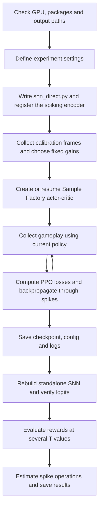

# Direct SNN training pipeline

This explains the current server notebook,
[GPU folders/doom_snn_direct_training (3).ipynb](<GPU folders/doom_snn_direct_training (3).ipynb>).
It describes the code on the laptop; server edits and saved run configurations may
differ. Writing this document does not change the notebooks.

## Overview

The agent learns to play ViZDoom directly from rewards using a spiking network.
Sample Factory supplies the reinforcement learning machinery, while the notebook
supplies a custom spiking encoder implemented in PyTorch.



A fresh experiment starts with newly initialized weights. It does not need the
trained ANN checkpoint or the converted SNN. An existing direct SNN checkpoint is
used to resume its training or evaluate its learned policy.

## 1. Server setup and settings

The first setup cell locates the repository, checks that CUDA works, limits CPU
thread use and records package versions in `outputs/environment.json`. It does
not install packages or request a cluster allocation.

The current local defaults are:

| Setting | Value | Meaning |
|---|---:|---|
| `ENV_NAME` | `doom_basic` | Game scenario |
| `SNN_T` | 8 | Internal spiking steps per observation |
| `SEED` | 0 | Seed passed to calibration and training |
| `SMOKE_TEST` | False | Full training is selected |
| `TOTAL_STEPS` | 2,000,000 | Sample Factory training target; 100,000 in smoke mode |
| `NUM_WORKERS` | Up to 8 | Based on CPU allocation/affinity and optional override |
| `ENVS_PER_WORKER` | 4 | Parallel environments per rollout worker |
| `BATCH_SIZE` | 1024 | Training batch size |
| `TARGET_RATE` | 0.15 | Initial calibration firing-rate target |
| `FEAT_SCALE` | 4.0 | Multiplier on final-layer mean firing rates |
| `N_EVAL_EPISODES` | 300 | Episodes for each evaluated T |

The earlier successful notebook output used approximately **6 million** training
steps, despite its source settings later showing 2 million. The current local copy
still targets 2 million; inspect the saved configuration and checkpoint step count
when comparing experiments.

## 2. The spiking policy

The notebook writes `snn_direct.py` so the custom encoder can be imported. It
registers the ViZDoom environments and `SpikingEncoder` with Sample Factory.

The image pathway is:

```text
RGB observation (3 × 72 × 128)
    → observation normalization
    → Conv1: 3 → 32, kernel 8, stride 4 → IF neurons
    → Conv2: 32 → 64, kernel 4, stride 2 → IF neurons
    → Conv3: 64 → 128, kernel 3, stride 2 → IF neurons
    → Flatten: 2304 features
    → Linear: 2304 → 512 → IF neurons
    → Mean firing rates × FEAT_SCALE
    ├─ Policy head → 4 action logits
    └─ Value head → estimated return, used during training
```

The four `doom_basic` actions are idle, move left, move right and attack. The heads
are conventional linear readouts; they do not emit spikes.

### What happens inside a neuron

For each internal step, a layer computes its input current using its weights and
bias, multiplied by that layer's fixed gain. The membrane voltage integrates this
current:

```text
voltage = voltage + current
spike = 1 if voltage >= 1, otherwise 0
voltage = voltage - spike
```

Voltage starts at `0.5`; the threshold is `1`. Reset subtracts the threshold rather
than setting voltage to zero. These are integrate-and-fire neurons without a leak
term, and each neuron emits at most one spike per internal step.

The first layer receives the same analog image throughout all T steps. Its
convolution is computed once per observation. Later layers receive the preceding
layer's spikes. Final-layer spikes are averaged over T and scaled before the heads.

**T is not the number of game frames.** T=8 means eight internal simulations for one
observation. Membrane states reset for every new observation; the model has no
persistent spiking memory across game decisions, and `use_rnn=False` disables the
Sample Factory recurrent core. Environment frame skipping is a separate setting.

## 3. Gain calibration before a fresh run

Poorly scaled input currents can make spiking layers silent or nearly always
active. Calibration chooses four fixed multipliers to put initial activity near
the target firing rate.

The current code:

1. Seeds Python, NumPy and PyTorch, plus the environment/action sampling.
2. Collects 800 images from random gameplay, keeping every second decision's image.
3. Divides pixels by 255, standardizes using these frames' per-pixel mean and
   variance, then clips to [-5, 5]. These temporary statistics are for calibration;
   training uses Sample Factory's observation normalizer.
4. Builds a temporary spiking trunk with orthogonal weights and zero biases.
5. Searches for each layer's gain, sequentially, using 18 binary-search iterations
   over log10(gain) in [-4, 4]. It targets an average firing rate of 0.15.
6. Saves frames, gains, measured rates, seed and T to a calibration artifact.

This search runs without gradients. Gains and feature scale are fixed buffers,
saved with model weights; PPO does not optimize them. Calibration is an initial
scale estimate, not a guarantee that the separately constructed training model has
exactly the same initial tensors or will maintain a 15% firing rate during learning.

For resumed training, retain the checkpoint's gains and saved configuration.
The notebook does not yet provide a dedicated resume mode: running every cell also
reruns calibration. The saved calibration artifact is written for reference, but
the notebook does not automatically restore it instead of collecting new frames.

## 4. Reinforcement learning and surrogate gradients

`run_rl(train_cfg)` starts Sample Factory's training machinery. In the usual
configuration, rollout, inference and learner processes work asynchronously.
The exact PPO and environment defaults come from the installed Sample Factory
version and the resolved/saved configuration, not just the notebook's few flags.

The learning cycle is:

1. Run parallel game environments and normalize observations.
2. Compute policy logits and a value estimate using the spiking encoder.
3. Sample actions during training and collect rewards, observations and episode
   boundaries.
4. Form rollout batches and estimate returns/advantages using the critic.
5. Compute PPO's clipped policy objective, value loss and exploration contribution.
6. Backpropagate and update trainable weights, then distribute updated weights to
   inference workers.

An advantage expresses how much better an outcome was than the value head
predicted. It provides the policy's learning signal; no labeled correct action is
required.

The hard spike threshold has no useful ordinary derivative. `SpikeFn` therefore
uses a triangular **surrogate gradient** in the backward pass:

```text
forward:  spike = 1 if x >= 0, otherwise 0
backward: approximate derivative = max(1 - abs(x), 0)
where x = voltage - threshold
```

The forward computation still uses binary spikes. During backward computation,
this approximation lets the PPO loss send gradients through the T internal steps
into convolutional and linear weights. The reset's spike term is detached by
default. This is direct SNN training with surrogate gradients, not ANN-to-SNN
conversion and not a local spike-timing-dependent plasticity rule.

## 5. Checkpoints: fresh training, resume and loading

Sample Factory saves weights, training state and configuration under:

```text
outputs/train_dir/<EXPERIMENT>/
    config.json
    checkpoint_p0/checkpoint_*.pth
    ...logs and other training artifacts...
```

Reusing the same experiment directory can resume a prior run. A new, unused name
is needed for an independent fresh run. A target of 6 million means a total target,
not necessarily six million additional steps after loading a checkpoint. Verify
the resolved config and logs when resuming.

The evaluation cell sorts `checkpoint_*.pth` and loads the last filename. It does
not explicitly choose the best-reward checkpoint. Loading with `map_location="cpu"`
initially places tensors in host memory; the reconstructed evaluator is then moved
to CUDA for gameplay.

The notebook includes a trusted-checkpoint `torch.load` wrapper. A notebook-local
patch may not reach a separately started training process; this was the cause of
the observed `weights_only` loading failure. The previously suggested
`TORCH_FORCE_NO_WEIGHTS_ONLY_LOAD=1` workaround is not currently added to the file.
Unrestricted checkpoint loading is appropriate only for trusted files.

## 6. Verify the standalone evaluator

After training, the notebook reads the saved configuration and reconstructs:

- Sample Factory's actor-critic, with its saved weights.
- `DirectSNN`, containing the same spiking trunk and policy head without the critic.

It compares their policy logits on the same already-normalized inputs. A maximum
difference below `1e-5` passes the check. It separately restores the trained
observation-normalizer statistics for gameplay evaluation.

This verifies weight extraction and matching policy computation. It does not show
that the agent learned a good policy, nor independently verify the whole game and
preprocessing setup.

## 7. Evaluate task performance

The standalone policy plays 300 episodes at each T in `{2, 4, 8, 16, 32, training T}`.
Weights remain fixed throughout this sweep: evaluating T=2 does not train a new
T=2 model.

Each decision normalizes the observation using the saved trained normalizer,
executes the SNN and chooses the largest-logit action deterministically. The loop
uses `ACTION_REPEAT=1`; any frame skipping inside the environment still applies.

Reported metrics include mean reward, standard deviation, standard error and
counts below reward thresholds. Up to 500 frames from evaluation at the training
T are retained for spike accounting.

Evaluation resets currently do not supply an explicit per-episode seed list.
Deterministic action selection therefore does not establish matched game episodes
across policies or T values.

## 8. Spike, operation and energy estimates

The notebook counts per-layer spikes on the retained evaluation frames and
estimates downstream accumulations. It separately counts the first convolution's
analog multiply-accumulates, since that current is reused across internal steps.

Estimated energy uses 4.6 pJ per MAC and 0.9 pJ per accumulation, with a membrane
update contribution. These are rough operation-based assumptions, not measured
RTX 6000 Ada electricity consumption, latency or training energy. Memory traffic
and other hardware overheads are not included.

The final comparison includes hardcoded historical ANN and converted-SNN results.
Only the direct-SNN rows are measured by this notebook execution.

## 9. Output files and current limits

Default paths are relative to `GPU folders/outputs`; `DOOM_OUTPUT_ROOT` can override
the root before Jupyter starts:

| Artifact | Location under output root |
|---|---|
| Package/GPU report | `environment.json` |
| Calibration inputs and gains | `calibration/<EXPERIMENT>/initialization.pt` |
| Training checkpoints/config/logs | `train_dir/<EXPERIMENT>/` |
| Metrics JSON | `direct_snn_results/<EXPERIMENT>_results.json` |
| Episode rewards per T | `direct_snn_results/<EXPERIMENT>_rewards_T<T>.npy` |

Outputs are ignored by Git. Pulling notebook code does not transfer trained models
or results. The environment report and calibration artifact can be overwritten
when their paths are reused. Results JSON uses some live notebook variables, so
rerunning calibration/settings before evaluating a different checkpoint can make
metadata disagree with that checkpoint.

Seeding and deterministic cuDNN settings improve repeatability but do not guarantee
identical asynchronous training across GPUs, processes or package versions.
The pipeline currently has no automatic multi-seed experiment runner, fixed final
evaluation seed list, or strict fresh/resume mode separation. These remain proposed
improvements rather than implemented features.
